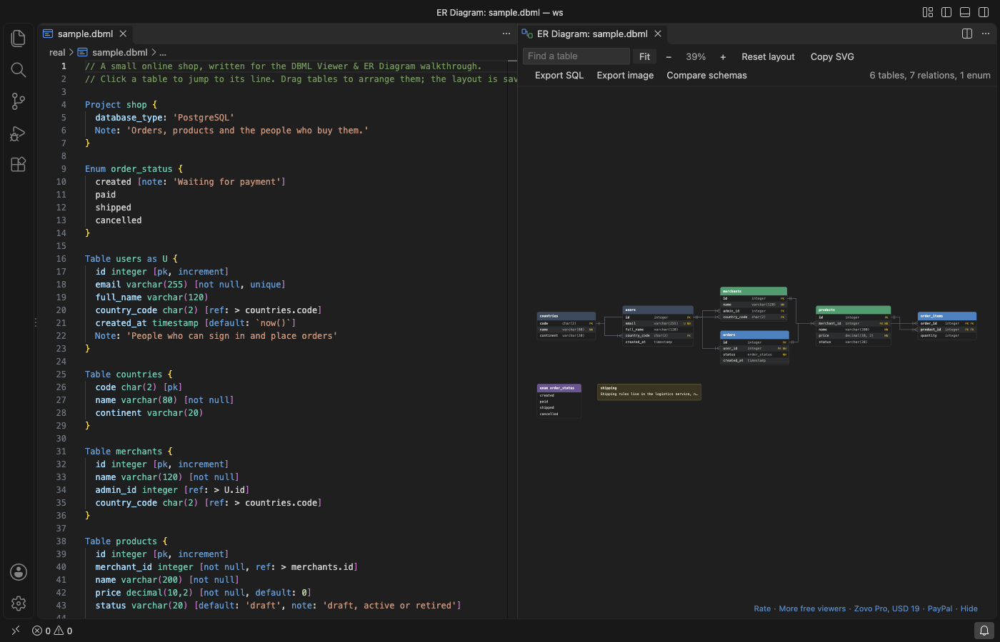
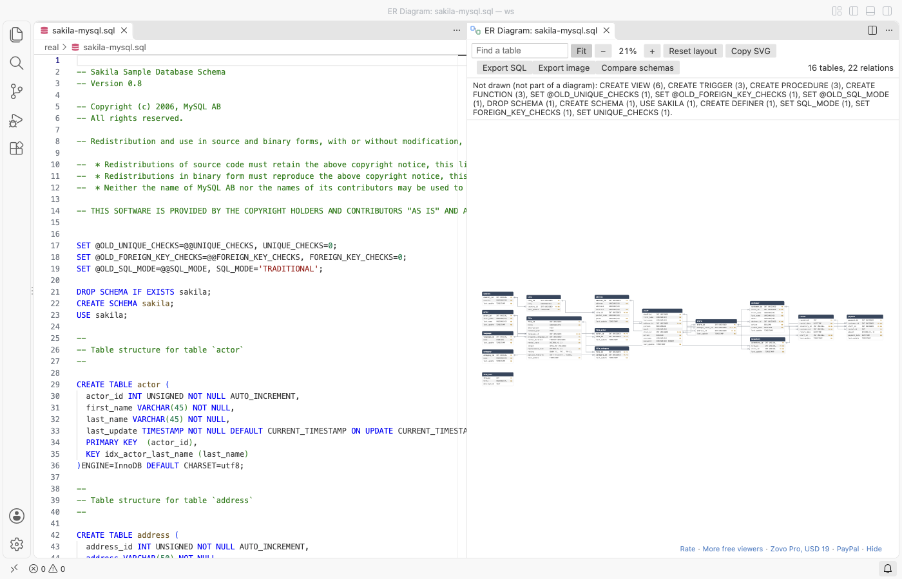
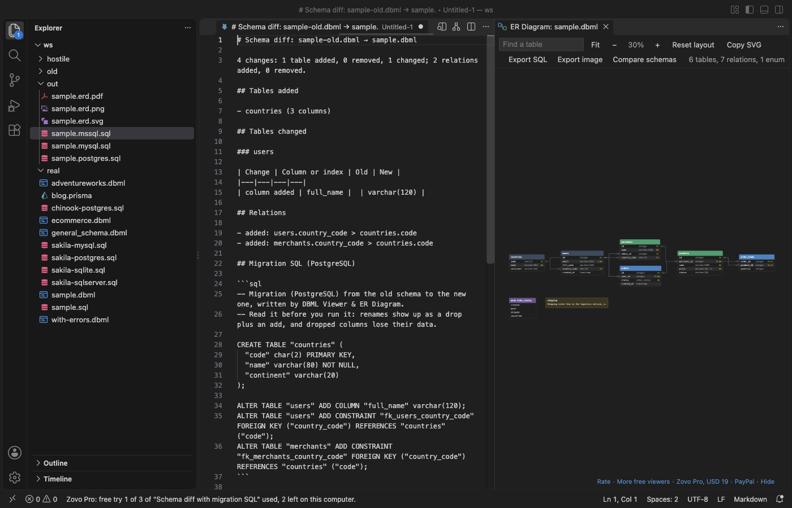

# DBML Viewer & ER Diagram for VS Code (DBML Preview, SQL to ER Diagram)

Zovo Pro: USD 19 once, every Zovo tool. The diagram, the DBML language support and Copy SVG are free, with no limit.

A DBML viewer that draws your schema as an ER diagram beside the editor and redraws it as you type. It also turns SQL into an ER diagram: open a PostgreSQL, MySQL, SQL Server or SQLite file with `CREATE TABLE` statements and click the diagram button. Prisma schemas work too. No sign-in, no network, no telemetry.

## What you get

- **Live DBML preview.** Open a `.dbml` file and click the diagram button in the editor title bar (or run **DBML Viewer: Open ER Diagram**). Tables show their columns and types with PK, FK, unique and not-null markers; enums and sticky notes have their own boxes.
- **Relations with crow's foot ends.** One-to-one, one-to-many and many-to-many lines are routed at right angles. Hover a line to highlight both columns and see the relation and its `ON DELETE` action.
- **Automatic layout you can change.** Referenced tables sit on the left and the tables that point at them on the right, with no overlaps. Drag a table to move it; the positions are kept for each file. **Reset layout** starts over. Schemas with 200 tables or more get a grid ordered by relation.
- **Find your way.** Zoom with Ctrl or Cmd + scroll, pan by dragging the background, **Fit** to see everything, search a table by name, and click a table or a column to jump to its line.
- **Colors.** `headercolor` on a table, or one color per `TableGroup`. Light, dark and high contrast themes.
- **Copy SVG.** Puts the diagram on the clipboard as an SVG image, for docs and pull requests.

### SQL to ER diagram

The same button shows up on `.sql` files that create tables. It reads `CREATE TABLE` with column types, `PRIMARY KEY`, `NOT NULL`, `UNIQUE`, `DEFAULT`, `AUTO_INCREMENT`, `IDENTITY`, `SERIAL` and `REFERENCES`; table constraints; `ALTER TABLE ... ADD [CONSTRAINT] FOREIGN KEY`; `CREATE INDEX`; `CREATE TYPE ... AS ENUM`; `COMMENT ON`; quoted names with `""`, backticks or `[]`; `GO` and `DELIMITER`. Statements that do not describe tables (`INSERT`, views, functions) are skipped and listed under the toolbar.

### DBML language support

- Syntax colors for `.dbml` files.
- Problems with line and column: an unknown keyword, a missing `}`, a `Ref` to a table that does not exist, a column that is not in its table.
- Outline of tables, columns, enums and groups.
- Go to definition: Ctrl or Cmd + click `users.id` in a `Ref` to jump to the column.

The reader covers `Project`, `Table` with alias and settings, columns with `pk`, `increment`, `unique`, `not null`, `null`, `default`, `note` and inline `ref`, `indexes` (composite and `pk`), `Ref` in short and long form with `<`, `>`, `-` and `<>` plus `delete` and `update` actions, composite references, `Enum`, `TableGroup`, `TablePartial`, sticky `Note`s, schema names, quoted names, comments and multi-line strings.

## Zovo Pro tools

Three tools for database work are part of Zovo Pro. Each has 3 free tries on your computer, and a try is used only when the tool produced its result (a file written, a report on screen). Escape or Cancel never uses one.

| Tool | Free | Zovo Pro |
|---|---|---|
| Live ER diagram for DBML, SQL and Prisma, layout, search, Copy SVG, DBML language support | yes | yes |
| **Export SQL**: DBML to `CREATE TABLE` scripts for PostgreSQL, MySQL, SQL Server or SQLite (types, keys, indexes, enums, foreign keys, comments), and SQL DDL to DBML | 3 tries | yes |
| **Export the diagram**: high-resolution PNG, SVG or a vector PDF, or a Markdown data dictionary (column, type, keys, nullable, default and note for every table) | 3 tries | yes |
| **Schema diff**: compare two DBML or SQL files, list the tables, columns, indexes and relations added, removed and changed, and write the migration SQL (`ALTER TABLE ...`) for your database | 3 tries | yes |

Zovo Pro is USD 19 once and turns on the Pro tools in every Zovo extension. Nothing about Pro shows when you open a file; it only comes up when you click one of the three tools. To hide the buttons, set `dbmlViewer.showProTools` to `false`.

## Settings

| Setting | Default | What it does |
|---|---|---|
| `dbmlViewer.showProTools` | `true` | Show the Export SQL, Export image and Compare schemas buttons |
| `dbmlViewer.showSupportLinks` | `true` | Show the small links at the bottom of the diagram |
| `dbmlViewer.askForRating` | `true` | Ask once, after a few days of use, for a rating |

## Notes

- Not affiliated with Holistics, dbdiagram.io or dbdocs.io. DBML is an open format by Holistics; this extension has its own reader and does not use their code.
- The SQL reader is made for schema files. It reads what describes tables and keys and skips the rest; it does not run or check SQL.
- Files up to 8 million characters are read. Reading runs in a background worker with a time limit, so a broken or huge file cannot freeze the editor.

## Support Zovo

Zovo Pro: USD 19 once, every Zovo viewer. [Get Zovo Pro on GitHub Sponsors](https://github.com/sponsors/theluckystrike/sponsorships?tier_id=679878) to turn on the Pro tools in this extension and in the other Zovo extensions you use. The free features stay free.

Zovo extensions have no ads and no tracking. They are made by [theluckystrike](https://github.com/theluckystrike) on GitHub. You can also support the work with no Pro:

- [Sponsor on GitHub](https://github.com/sponsors/theluckystrike)
- [PayPal](https://www.paypal.com/paypalme/najzzz)
- [Follow theluckystrike on GitHub](https://github.com/theluckystrike)

### Need your format supported?

Open a [format request](https://github.com/theluckystrike/dbml-viewer-vscode/issues/new?template=format-request.yml) with a sample file, and I reply there whether it can be done. For USD 299 once, through [this GitHub Sponsors tier](https://github.com/sponsors/theluckystrike/sponsorships?tier_id=679995), I add your file format or a missing feature to this extension, with tests, within 7 days.

## More tools by Zovo

- [Postgres & MySQL Query Client - SQL Database Tool (SQLite, CSV Export)](https://marketplace.visualstudio.com/items?itemName=zovo.zovo-sql-client) runs Postgres and MySQL queries, edits rows and exports CSV.
- [Graphviz Viewer & DOT Viewer (Live Preview)](https://marketplace.visualstudio.com/items?itemName=zovo.zovo-graphviz-preview) shows a live preview of DOT files and exports SVG or PNG.
- [MongoDB Client & MongoDB GUI: Query, Edit Documents, Aggregation & Indexes](https://marketplace.visualstudio.com/items?itemName=zovo.zovo-mongodb-client) queries and edits MongoDB documents in a grid or as JSON.
- [Oracle SQL & SQL Server Query Client (MSSQL, T-SQL, PLSQL, Oracle Database Tool)](https://marketplace.visualstudio.com/items?itemName=zovo.zovo-oracle-sqlserver-client) runs Oracle SQL and T-SQL and browses tables.
- [SQL Safe Formatter & Format on Save: PostgreSQL, MySQL, T-SQL, PL/SQL (Zovo)](https://marketplace.visualstudio.com/items?itemName=zovo.zovo-sql-formatter) formats SQL in 20 dialects and keeps strings and comments as written.

See [all Zovo extensions on the Marketplace](https://marketplace.visualstudio.com/publishers/zovo).
